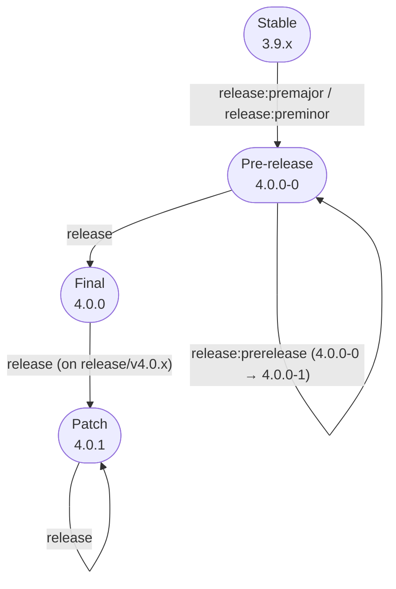
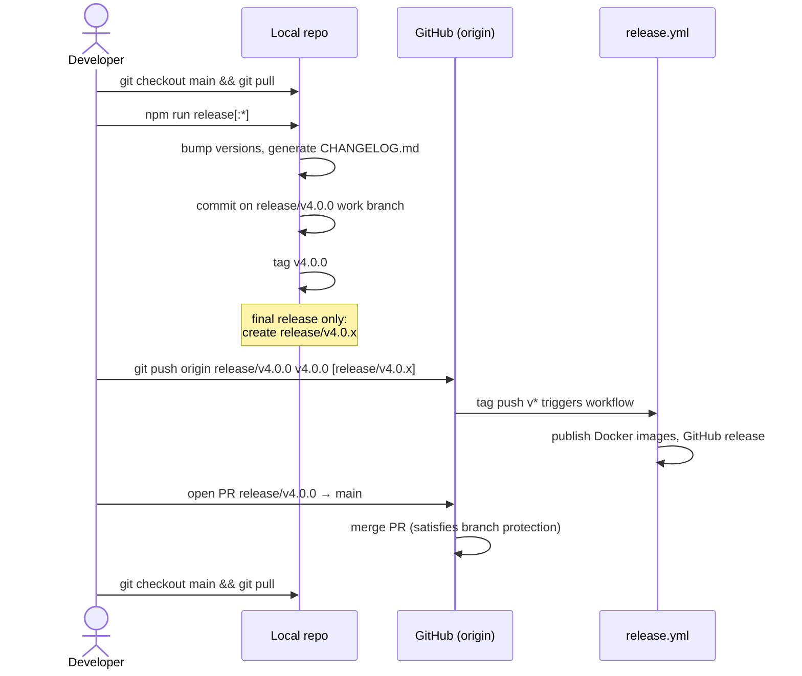
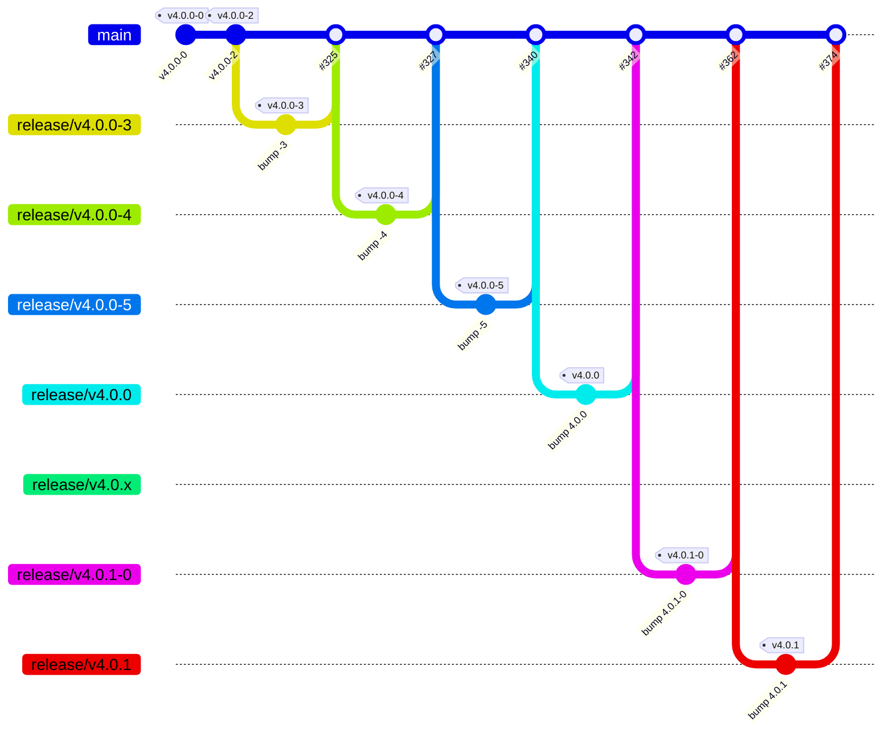

Releasing Translatr
===================

Releases are cut with `lets-release` (in [`lets-release/`](lets-release)), driven by these npm
scripts:

```
npm run release:premajor    # start a new major release, e.g. 3.9.x -> 4.0.0-0
npm run release:preminor    # start a new minor release, e.g. 3.9.x -> 3.10.0-0
npm run release:prerelease  # bump an existing pre-release, e.g. 4.0.0-0 -> 4.0.0-1
npm run release             # finalize the current version (drops the pre-release suffix,
                             # or bumps a patch), e.g. 4.0.0-0 -> 4.0.0
```

How the version moves through a release cycle:



Pass the GitHub token needed for changelog generation when finalizing a release:

```
CHANGELOG_GITHUB_TOKEN=ABCDEF npm run release -- --github-token="$CHANGELOG_GITHUB_TOKEN"
```

## Branch protection

`main` is protected and cannot be pushed to directly. Because of that, every command above that
would otherwise commit straight onto `main` instead commits onto a throwaway work branch named
after the resulting version, e.g. `release/v4.0.0-0` or `release/v4.0.0`, and checks that branch
out for you. `lets-release` never pushes anything itself — after it finishes, it prints the
remaining steps, which always follow this shape:

1. Push the work branch (and the tag, if one was created):
   ```
   git push origin release/v4.0.0-0 v4.0.0-0
   ```
2. Open a pull request from the work branch into `main` and merge it (this is what satisfies
   branch protection).
3. Check out `main` again (and pull) before running the next `npm run release*` command, since
   each of them expects to start from an up-to-date `main`.



This applies to `release:premajor`, `release:preminor`, every `release:prerelease` bump on that
same major/minor line, and the final `npm run release`. A `release:prerelease` bump that happens
on an existing patch release branch (not `main`) is committed there directly instead, since that
branch isn't protected.

`npm run release` (finalizing a major/minor release) additionally creates the long-lived release
branch for that line (e.g. `release/v4.0.x`), which is used for future patch releases on that
version and is pushed alongside the work branch and tag.

The tag itself (`v4.0.0-0`, `v4.0.0`, ...) can always be pushed directly — tags aren't subject to
branch protection — and pushing it is what triggers [`.github/workflows/release.yml`](.github/workflows/release.yml)
to build and publish the release.

## Release history

### 4.x

The 4.x line is the first one cut under branch protection. Early pre-releases (`v4.0.0-0`,
`v4.0.0-2`) were tagged on `main` directly; from `v4.0.0-3` on, every bump went through a work
branch and a PR into `main`, in this order:

| Date       | Tag        | Work branch        | PR   | Merged     |
|------------|------------|--------------------|------|------------|
| 2026-09-12 | `v4.0.0-0` | — (tagged on main) | —    | —          |
| 2026-09-13 | `v4.0.0-2` | — (tagged on main) | —    | —          |
| 2026-09-13 | `v4.0.0-3` | `release/v4.0.0-3` | #325 | 2026-09-13 |
| 2026-09-13 | `v4.0.0-4` | `release/v4.0.0-4` | #327 | 2026-09-13 |
| 2026-09-15 | `v4.0.0-5` | `release/v4.0.0-5` | #340 | 2026-09-15 |
| 2026-09-15 | `v4.0.0`   | `release/v4.0.0`   | #342 | 2026-09-15 |
| 2026-09-19 | `v4.0.1-0` | `release/v4.0.1-0` | #362 | 2026-09-19 |
| 2026-11-03 | `v4.0.1`   | `release/v4.0.1`   | #374 | 2026-11-08 |

`v4.0.0` also created the long-lived `release/v4.0.x` branch; `production` points at the same
commit. `v4.0.1` was cut from `main` (after a `v4.0.1-0` pre-release there), not from
`release/v4.0.x`, so that branch and `production` still sit on `v4.0.0`.



### 3.x

Released before branch protection, so there are no release PRs: versions were committed and
tagged directly, with one long-lived branch per minor line (`release/v3.1.x`, `release/v3.2.x`,
`release/v3.3.x`) for patches.

| Line | Tags                                                         | Dates                    |
|------|--------------------------------------------------------------|--------------------------|
| 3.1  | `v3.1.0`–`v3.1.5`, `v3.1.6-1`–`v3.1.6-3`, `v3.1.6`           | 2020-11-09 – 2020-11-28  |
| 3.2  | `v3.2.0-0`, `v3.2.0`                                         | 2020-12-06 – 2021-05-31  |
| 3.3  | `v3.3.0`–`v3.3.3`                                            | 2022-04-15 – 2022-04-16  |
